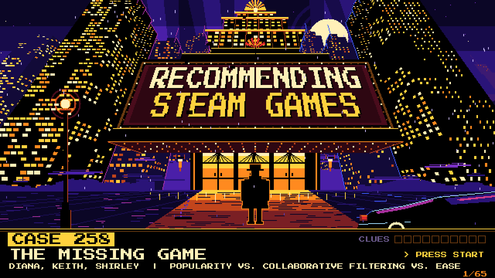
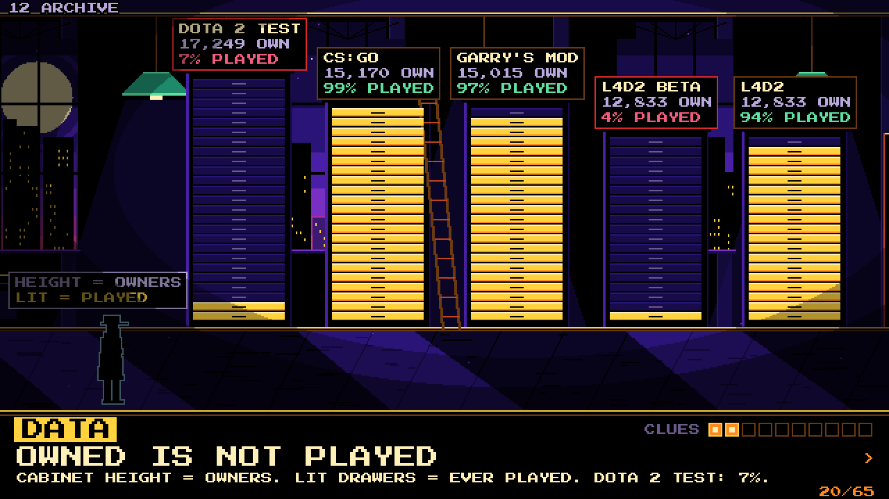
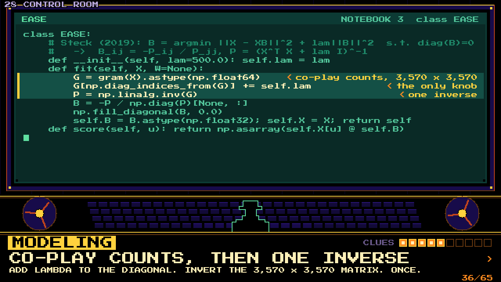
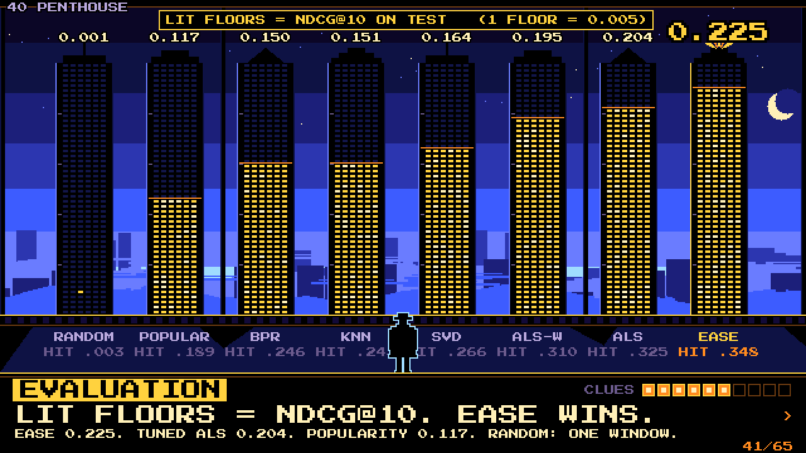

# CSE 258 · Steam game recommender

### ▶ [Play the presentation: xibahbah.github.io/cse-258](https://xibahbah.github.io/cse-258/)

*Case 258: The Missing Game.* A pixel-art walk through our CSE 258 Assignment 2 project, one floor per rubric section. Right arrow or space to advance, left arrow to go back, `F` for fullscreen. The step number in the bottom-right corner matches the [speaker script](claude-work/deliverables/Case%20258%20Speaker%20Script.md).

| Data | Modeling | Evaluation |
| --- | --- | --- |
|  |  |  |

## What is where

- **[`claude-work/deliverables/`](claude-work/deliverables):** the files to submit and present from: the notebook, `workbook.html`, and the speaker script (PDF, Word, Markdown).
- **[`claude-work/presentation/`](claude-work/presentation):** the presentation source. Open `index.html` in a browser; no build step.
- **[`claude-work/`](claude-work/README.md):** the full project README, experiments, figures and build scripts.
- The previous notebook and script, and the assignment handout, are at the repository root.

[Start with the compact course guide](llms.txt) · [Browse the course materials](course/README.md) · [Public source inventory](course/inventory.md)
